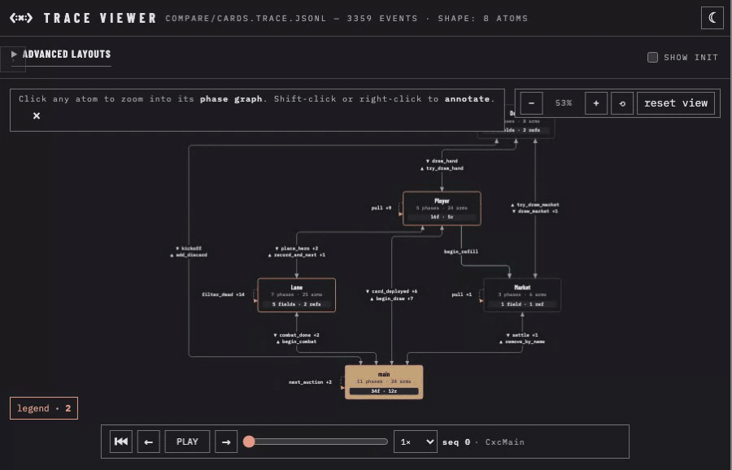

<h1 align="center">
  <picture>
    <source media="(prefers-color-scheme: dark)" srcset="docs/branding/mark-white.svg">
    
  </picture>
</h1>

cxc is a programming language for the Apple ecosystem that targets the libobjc runtime shared with Objective-C and Swift, so programs interoperate directly with Foundation, AppKit, and UIKit without a bridge layer.

cxc is object-oriented and functional with no imperative control, which means no assignments, no loops, no breaks, no continues. Logic lives in pure functions, and state transitions and iteration both happen through message passing.



Every program is a graph of atoms, each owning state and running a lifecycle state machine. I built cxc so running programs stay inspectable through more than one surface. The trace viewer renders each run as a zoomable graph. Hot-reload swaps methods on live programs without restart, and a REPL socket delivers messages and fault-injection into running programs.

Example:

```elixir
def PlayableUnit(card: Card!, owner_seat: Int!):
    current_hp:     Int!  = card.hp
    silenced:       Bool! = false
    thorn_attached: Bool! = false
    atk_bonus:      Int!  = 0

    total_attack :- card.attack + atk_bonus
    reflect_bonus :- ||: card.combat_effect.kind == EffectKind.reflect_bonus : card.combat_effect.amount
                     ||: thorn_attached : 1
                     ||: else : 0
    effective_damage(amount: Int!) :- ||: card.combat_effect.kind == EffectKind.damage_cap
                                        : amount.min(card.combat_effect.amount)
                                      ||: else : amount

    -> alive

    alive <: take_damage(amount: Int!) -> alive
        |: self.effective_damage(amount) < current_hp
        current_hp => current_hp - self.effective_damage(amount)

    alive <: take_damage(amount: Int!) -> dead
        |: self.effective_damage(amount) >= current_hp
        current_hp => 0

    alive <: heal(amount: Int!) -> alive
        current_hp => (current_hp + amount).min(card.hp)

    alive <: silence -> alive
        silenced => true

    dead <: * -> dead

    -> end
```

[MIT](LICENSE) licensed.

## Try it

cxc needs macOS, `clang` from Xcode command-line tools, and a Clojure CLI.

```bash
brew install clojure/tools/clojure
```

```bash
git clone https://github.com/danieltanfh95/cxc
cd cxc/compiler
clojure -M:test
```

```bash
./bin/cxc compile examples/hello.cxc /tmp/cxc-hello
/tmp/cxc-hello/hello
```

The test suite compiles and runs every example under [compiler/examples/](compiler/examples/).

## Writing cxc

- [Your first atom](docs/writing-corvid/01-your-first-atom.md) - a counter, end to end.
- [Language tour](docs/writing-corvid/02-language-tour.md) - syntax quick-reference.
- [Design patterns](docs/writing-corvid/03-design-patterns.md) - shapes worth reaching for.
- [Common mistakes](docs/writing-corvid/04-common-mistakes.md) - what to avoid.
- [Worked example](docs/writing-corvid/05-worked-example.md) - a task queue, annotated.

Skills for both humans and agents:

- [cxc-authoring](.claude/skills/cxc-authoring/SKILL.md) - rules and patterns for writing new `.cxc` code.
- [cxc-cleanup-audit](.claude/skills/cxc-cleanup-audit/SKILL.md) - audit an existing `.cxc` file against the 25 anti-patterns from the guide.

## Where things live

**Language**
- [MANUAL.md](MANUAL.md) - one-page user manual.
- [docs/writing-corvid/](docs/writing-corvid/) - authoring guide (your first atom, language tour, design patterns, common mistakes, worked example).
- [docs/spec/spec-cxc-v1.0.md](docs/spec/spec-cxc-v1.0.md) - the language spec (normative).
- [docs/PATTERNS.md](docs/PATTERNS.md) - onboarding by translation from other languages.

**Compiler and stdlib**
- [compiler/](compiler/) - the bootstrap compiler in Clojure. Reads `.cxc`, emits `.m`, drives clang.
- [compiler/resources/prelude/](compiler/resources/prelude/) - stdlib capabilities (Console, Env, Clock, Random, Fs, Http, Subprocess, Json, Hash, WallTime, Reflection).
- [compiler/BOARD.md](compiler/BOARD.md) - landed-and-open items per cycle.

**Tooling**
- `cxc compile <src.cxc> <out-dir>` runs parse, lower, emit, clang.
- `cxc view [<trace.jsonl>]` opens the browser trace viewer.
- `cxc coverage <binary> <trace.jsonl>...` prints the static-vs-fired arm diff.
- `cxc test <fixture.edn>...` runs the EDN scenario harness (`:arms_contain`, `:arms_absent`, `:arm_count`, `:ordered_after`, `:chaos`).
- `cxc trace-index <trace.jsonl> <op>` runs scan queries (`atom-of`, `arms-of`, `between`, `count-by-kind`, `tally-arms`).
- REPL IPC via `/tmp/cxc-repl-<pid>.sock` with ops `read`, `send`, `chaos`, `swap`.
- Hot-reload via `cxc_hot_reload_swap(cls, sel, dylib, sym)` plus REPL `swap`.
- Reflection via `class_names`, `phase_names_of`, `method_names_of`.
- References at [cli-reference.md](.claude/skills/cxc/references/cli-reference.md), [repl.md](.claude/skills/cxc/references/repl.md), [trace-review.md](.claude/skills/cxc/references/trace-review.md).

**Design docs**
- [docs/design/hot-reload.md](docs/design/hot-reload.md), [docs/design/trace-store.md](docs/design/trace-store.md), [docs/design/trace-annotation.md](docs/design/trace-annotation.md), [docs/design/runtime-shape.md](docs/design/runtime-shape.md).

**Examples**
- [docs/examples/](docs/examples/) - programs that exercise live shapes.
