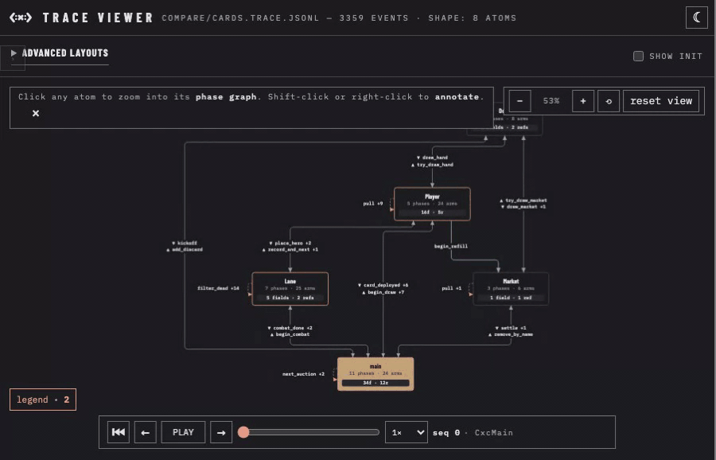

<h1 align="center">
  <picture>
    <source media="(prefers-color-scheme: dark)" srcset="docs/branding/mark-white.svg">
    
  </picture>
</h1>

cxc is a language for the Apple ecosystem based on lifecycles. It emits Objective-C, and supports functional (codata) object-oriented programming without imperative baggage.



cxc compiles each program into a graph of atoms, where each atom owns state and runs a lifecycle state machine. The trace viewer renders each run as a zoomable graph, and the capture above comes from [compiler/tools/compare/cards.cxc](compiler/tools/compare/cards.cxc).

Example:

```elixir
def PlayableUnit(card: Card!, owner_seat: Int!):
    current_hp:     Int!  = card.hp
    silenced:       Bool! = false
    thorn_attached: Bool! = false
    atk_bonus:      Int!  = 0

    total_attack :- card.attack + atk_bonus
    reflect_bonus :- ||: card.combat_effect.kind == EffectKind.reflect_bonus : card.combat_effect.amount
                     ||: thorn_attached : 1
                     ||: else : 0
    effective_damage(amount: Int!) :- ||: card.combat_effect.kind == EffectKind.damage_cap
                                        : amount.min(card.combat_effect.amount)
                                      ||: else : amount

    -> alive

    alive <: take_damage(amount: Int!) -> alive
        |: self.effective_damage(amount) < current_hp
        then: current_hp => current_hp - self.effective_damage(amount)

    alive <: take_damage(amount: Int!) -> dead
        |: self.effective_damage(amount) >= current_hp
        then: current_hp => 0

    alive <: heal(amount: Int!) -> alive
        then: current_hp => (current_hp + amount).min(card.hp)

    alive <: silence -> alive
        then: silenced => true

    dead <: * -> dead

    -> end
```

License: [MIT](LICENSE).

## Try it

cxc needs macOS, `clang` from Xcode command-line tools, and a Clojure CLI.

```bash
brew install clojure/tools/clojure
```

```bash
git clone https://github.com/danieltanfh95/cxc
cd cxc/compiler
clojure -M:test
```

To compile and run one program:

```bash
./bin/cxc compile examples/hello.cxc /tmp/cxc-hello
/tmp/cxc-hello/hello
```

The test suite compiles and runs every example under [compiler/examples/](compiler/examples/). [compiler/examples/README.md](compiler/examples/README.md) is the coverage index.

## Writing Corvid

- [Your first atom](docs/writing-corvid/01-your-first-atom.md): a counter, end to end.
- [Language tour](docs/writing-corvid/02-language-tour.md): syntax quick-reference.
- [Design patterns](docs/writing-corvid/03-design-patterns.md): shapes worth reaching for.
- [Common mistakes](docs/writing-corvid/04-common-mistakes.md): what to avoid.
- [Worked example](docs/writing-corvid/05-worked-example.md): a task queue, annotated.

Skills for both humans and agents:

- [cxc-authoring](.claude/skills/cxc-authoring/SKILL.md): rules and patterns for writing new `.cxc` code.
- [cxc-cleanup-audit](.claude/skills/cxc-cleanup-audit/SKILL.md): audit an existing `.cxc` file against the 25 anti-patterns from the guide.

## Where things live

- [MANUAL.md](MANUAL.md): one-page user manual.
- [docs/writing-corvid/](docs/writing-corvid/): authoring guide for humans and agents.
- [docs/spec/spec-cxc-v1.0.md](docs/spec/spec-cxc-v1.0.md): the language spec (normative).
- [docs/PATTERNS.md](docs/PATTERNS.md): onboarding by translation from other languages.
- [compiler/](compiler/): the bootstrap compiler in Clojure. Reads `.cxc`, emits `.m`, drives clang.
- [compiler/resources/prelude/](compiler/resources/prelude/): stdlib capabilities.
- [docs/examples/](docs/examples/): aspirational programs that depend on unlanded shapes (plugins, L7 bundles).
